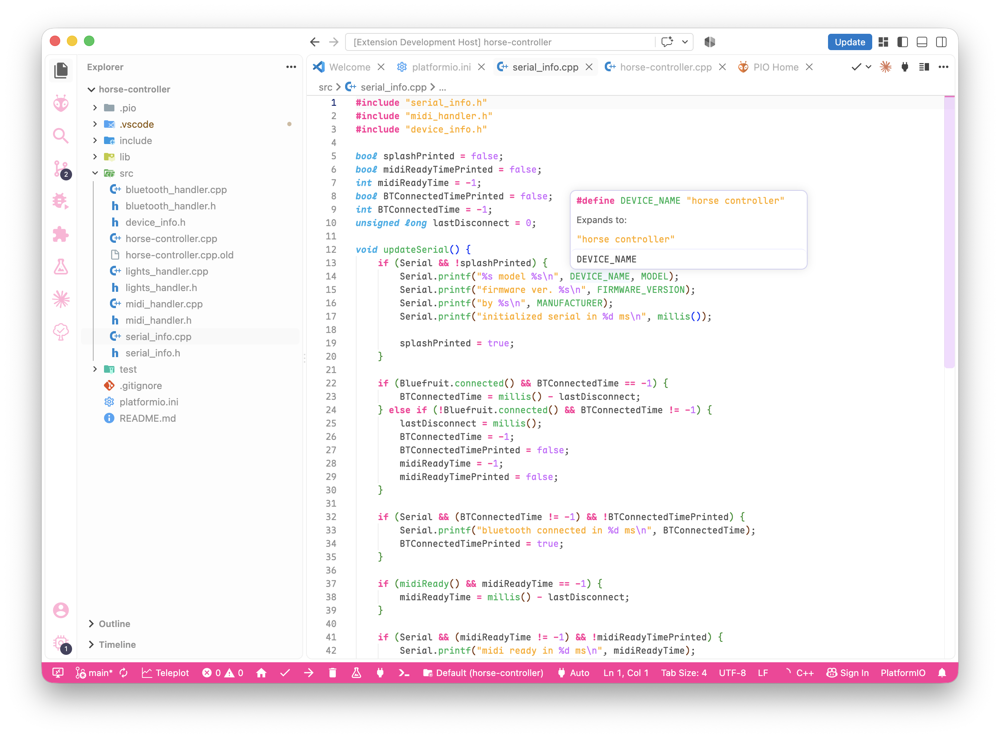
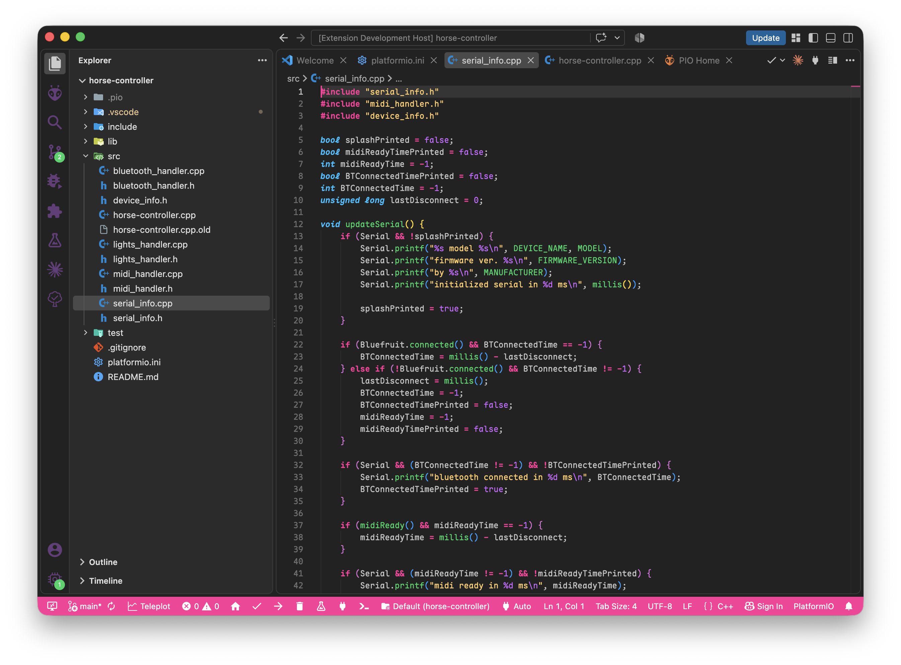

# oddhorse theme for vscode

**oddhorse theme** is a syntax and ui theme that uses a bright palette of colors including pink, blue, turquoise, green, purple, and orange.

this theme pack includes 2 themes, 1 light (nice) and 1 dark (overrated).

## get it

on the visual studio code marketplace.

colors curated by [Tinacious Design](http://tinaciousdesign.com) and edited by oddhorse. please give her original theme some love [here](https://tinaciousdesign.com/portfolio/visual-studio-code-theme/).

## light

## dark

:3
